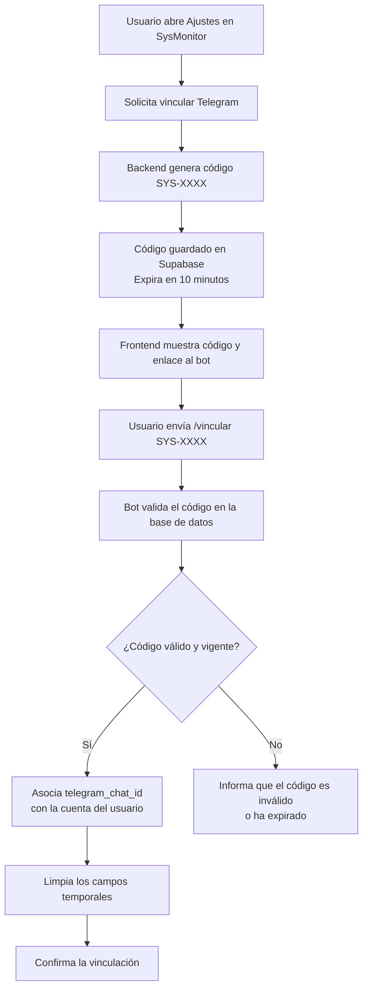

# Proyecto-POO3
# Informe de Cambios y Funcionalidades Desarrolladas

Este documento detalla el historial de cambios, integraciones y refactorizaciones realizadas, desde la integración del flujo de autenticación y almacenamiento de usuarios con Supabase hasta la vinculación con el bot de alertas de Telegram.

---

## Índice

1. [Ajustes en el menú, dashboard y miembros](#1-ajustes-en-el-menú-dashboard-y-miembros)
2. [Integración preliminar del bot de Telegram](#2-integración-preliminar-del-bot-de-telegram)
3. [Instalación del bot y correcciones en MenuAjustes](#3-instalación-del-bot-y-correcciones-en-menuajustes)
4. [Ajustes de tokens para el bot de Telegram](#4-ajustes-de-tokens-para-el-bot-de-telegram)
5. [Ajustes finales del bot de Telegram](#5-ajustes-finales-del-bot-de-telegram)
6. [Personalización del mensaje de aceptación](#6-personalización-del-mensaje-de-aceptación)
7. [Resumen del flujo de vinculación](#7-resumen-del-flujo-de-vinculación)

---

## 1. Ajustes en el menú, dashboard y miembros

**Commit:** `ajustes en el menu, dashboard y miembros: ahora figura los datos de usuario en el perfil y la lista de miembros por defecto vacía`

### Descripción

Se adaptaron el panel de control (`Dashboard.jsx`) y el menú de configuraciones (`MenuAjustes.jsx`) para mostrar dinámicamente los datos del usuario autenticado, obtenidos durante el inicio de sesión y almacenados en Supabase.

Además, se modificó el servicio de miembros para que la lista se inicialice vacía, evitando la presentación de datos simulados.

### Archivos modificados

- `frontend/src/vistas/Dashboard.jsx`
- `frontend/src/componentes/MenuAjustes/MenuAjustes.jsx`
- `frontend/src/services/miembros.js`

### Cambios relevantes

- **Dashboard:** se pasó el objeto `usuario` al componente `MenuAjustes` mediante una propiedad (`prop`) en el archivo **Dashboard.jsx**.
- **Perfil:** se habilitó la visualización de los datos del usuario autenticado, como nombre, correo electrónico y rol a través del archivo **MenuAjustes.jsx**.
- **Miembros:** se eliminó el conjunto de datos simulados por defecto en el archivo **miembros.js** para que la lista comience vacía hasta recibir información de la fuente correspondiente.

---

## 2. Integración preliminar del bot de Telegram

**Commit:** `bot telegram preliminar`

### Descripción

Se creó la estructura inicial para integrar el bot oficial de alertas de Telegram con SysMonitor.

Se incorporaron funcionalidades en el backend para enviar mensajes, procesar comandos y generar códigos temporales de vinculación. También se agregó una interfaz en el frontend para solicitar estos códigos.

### Archivos modificados y creados

**Backend**

- `backend/bot/telegram.py`
- `backend/bot/telegram_bot.py`
- `backend/controllers/auth_controller.py`
- `backend/routers/auth_router.py`

**Frontend**

- `frontend/src/componentes/MenuAjustes/MenuAjustes.jsx`

### A. Envío de alertas mediante `telegram.py`

Se implementó una función para enviar mensajes directamente a la API de Telegram mediante peticiones HTTP POST.

```python
import os
import requests

TELEGRAM_BOT_TOKEN = os.environ["TELEGRAM_BOT_TOKEN"]

def enviar_alerta_telegram(chat_id: int, mensaje: str):
    url = (
        f"https://api.telegram.org/"
        f"bot{TELEGRAM_BOT_TOKEN}/sendMessage"
    )

    payload = {
        "chat_id": chat_id,
        "text": mensaje,
        "parse_mode": "Markdown"
    }

    respuesta = requests.post(url, json=payload, timeout=10)
    respuesta.raise_for_status()

    return respuesta.json()
```

La función recibe el identificador del chat y el mensaje, construye la petición y devuelve la respuesta de la API de Telegram.

> **Nota:** el código anterior representa la funcionalidad documentada utilizando una variable de entorno para proteger las credenciales. Debe adaptarse a la implementación real del proyecto.

### B. Vinculación de usuarios mediante `telegram_bot.py`

Se incorporó un bot basado en la biblioteca `python-telegram-bot`, encargado de escuchar el comando `/vincular <CODIGO>`. Dicho **CÓDIGO** es una clave aleatoria que se genera para luego poder identificar al usuario con el chat correspondiente en la BASE DE DATOS en SUPABASE a través de la variable  `telegram_chat_id`. 

El proceso contempla las siguientes operaciones:

1. Recibir el comando enviado por el usuario.
2. Validar que se haya proporcionado un código.
3. Consultar la base de datos para verificar que el código exista y no haya expirado.
4. Asociar el identificador del chat de Telegram con la cuenta correspondiente.
5. Limpiar los campos temporales utilizados durante la vinculación.
6. Responder al usuario con un mensaje de confirmación o error.

El siguiente fragmento ilustra la lógica principal de vinculación:

```python
import os

import psycopg
from dotenv import load_dotenv
from psycopg.rows import dict_row
from telegram import Update
from telegram.ext import (
    ApplicationBuilder,
    CommandHandler,
    ContextTypes,
)

load_dotenv()

DATABASE_URL = os.environ["DATABASE_URL"]
TELEGRAM_BOT_TOKEN = os.environ["TELEGRAM_BOT_TOKEN"]


async def vincular_comando(
    update: Update,
    context: ContextTypes.DEFAULT_TYPE
):
    chat_id = update.effective_chat.id
    args = context.args

    if not args:
        await update.message.reply_text(
            "⚠️ Por favor ingresá tu código. "
            "Ejemplo: /vincular SYS-1234"
        )
        return

    codigo_ingresado = args[0].strip()

    with psycopg.connect(
        DATABASE_URL,
        row_factory=dict_row
    ) as conn:
        with conn.cursor() as cur:
            cur.execute(
                """
                SELECT id, nombre
                FROM usuarios
                WHERE telegram_cod = %s
                  AND telegram_cod_expira_en > NOW()
                """,
                (codigo_ingresado,)
            )

            usuario = cur.fetchone()

            if usuario:
                cur.execute(
                    """
                    UPDATE usuarios
                    SET telegram_chat_id = %s,
                        telegram_cod = NULL,
                        telegram_cod_expira_en = NULL
                    WHERE id = %s
                    """,
                    (chat_id, usuario["id"])
                )

                conn.commit()

                await update.message.reply_text(
                    f"✅ ¡Hola {usuario['nombre']}! "
                    "Tu cuenta de SysMonitor ha sido "
                    "vinculada exitosamente."
                )
            else:
                await update.message.reply_text(
                    "❌ El código es inválido o ha expirado. "
                    "Generá uno nuevo desde los ajustes "
                    "de la web."
                )


if __name__ == "__main__":
    app = (
        ApplicationBuilder()
        .token(TELEGRAM_BOT_TOKEN)
        .build()
    )

    app.add_handler(
        CommandHandler("vincular", vincular_comando)
    )

    print("🤖 Bot de Telegram iniciado.")

    app.run_polling()
```

Este ejemplo refleja la lógica descrita en el historial de cambios. Para utilizarlo directamente, es necesario verificar que coincida con la implementación actual, el esquema de la base de datos y las versiones instaladas de las dependencias.

### C. Backend: controlador y router de autenticación

Se agregó la lógica necesaria para generar códigos temporales de vinculación con el formato `SYS-XXXX`.

Las funcionalidades incorporadas incluyen:

- Generación de códigos de vinculación.
- Persistencia del código en la tabla `usuarios` de Supabase.
- Asignación de una expiración de 10 minutos.
- Exposición del endpoint de generación de códigos mediante el router de autenticación.

Endpoint utilizado:

```text
/auth/telegram/generar-codigo
```

### D. Frontend: integración en `MenuAjustes.jsx`

Se incorporó una interfaz en la sección de perfil que permite:

- Solicitar un código temporal de vinculación.
- Visualizar el código generado.
- Consultar las instrucciones para completar la vinculación.
- Acceder directamente al bot oficial de Telegram.

---

## 3. Instalación del bot y correcciones en MenuAjustes

**Commit:** `install bot telegram en backend y ajustes de código en MenuAjustes`

### Descripción

Se corrigieron problemas relacionados con las reglas de Hooks de React en el componente `MenuAjustes.jsx` y se instalaron las dependencias necesarias para ejecutar el bot en el backend.

### Problema identificado

Al abrir el menú de ajustes, React mostraba errores similares a los siguientes:

```text
Rendered more hooks than during the previous render.

React has detected a change in the order of Hooks called by MenuAjustes.
```

Estos errores pueden producirse cuando los Hooks se ejecutan de manera condicional o cuando cambia su orden entre renderizados.

### Solución aplicada

- Se trasladaron las declaraciones de `useState` relacionadas con Telegram al inicio del componente.
- Se ubicaron los Hooks antes de las condiciones y de los retornos anticipados, como `if (!abierto) return null;`.
- Se aseguró la instalación de las dependencias necesarias para el bot y la carga de variables de entorno.

Dependencias involucradas:

- `python-telegram-bot`
- `python-dotenv`
- `psycopg`

La corrección permite mantener un orden consistente de ejecución de los Hooks y facilita el funcionamiento del componente durante los distintos renderizados.

---

## 4. Ajustes de tokens para el bot de Telegram

**Commit:** `ajustes de tokens para bot telegram`

### Descripción

Se revisó la configuración del token de acceso a la API de Telegram para garantizar que los componentes encargados de escuchar comandos y enviar mensajes utilicen las credenciales correspondientes al mismo bot.

### Componentes involucrados

- `backend/bot/telegram.py`
- `backend/bot/telegram_bot.py`

### Consideraciones de seguridad

El token del bot debe almacenarse como una variable de entorno y no incluirse directamente en el código fuente.

Ejemplo de configuración:

```env
TELEGRAM_BOT_TOKEN=tu_token_del_bot
DATABASE_URL=tu_url_de_conexion
```

El archivo `.env` no debe subirse al repositorio. Se recomienda incorporarlo a `.gitignore` y proporcionar un archivo `.env.example` con nombres de variables y valores de ejemplo, sin credenciales reales.

Si un token real fue publicado en el repositorio o compartido públicamente, debe revocarse y regenerarse desde BotFather.

---

## 5. Ajustes finales del bot de Telegram

**Commit:** `ajustes finales bot telegram`

### Descripción

Se actualizó la interfaz del frontend para que el enlace externo abra directamente el bot oficial de SysMonitor.

### Modificación en `MenuAjustes.jsx`

```jsx
<a
  href="https://t.me/sysmonitoralert_bot"
  target="_blank"
  rel="noreferrer"
  style={{ color: "#fff", textDecoration: "underline" }}
>
  @sysmonitoralert_bot
</a>
```

### Resultado

El usuario puede acceder directamente a `@sysmonitoralert_bot` desde la sección de ajustes y continuar con el proceso de vinculación de su cuenta.

---

## 6. Personalización del mensaje de aceptación

**Commit:** `mensaje de aceptación bot`

### Descripción

Se personalizó el mensaje que recibe el usuario cuando la vinculación entre su cuenta de SysMonitor y Telegram se completa correctamente.

### Modificación en `telegram_bot.py`

Después de actualizar la base de datos y confirmar la transacción, el bot responde con un mensaje que informa sobre el resultado de la operación.

```python
if usuario:
    cur.execute(
        """
        UPDATE usuarios
        SET telegram_chat_id = %s,
            telegram_cod = NULL,
            telegram_cod_expira_en = NULL
        WHERE id = %s
        """,
        (chat_id, usuario["id"])
    )

    conn.commit()

    await update.message.reply_text(
        f"✅ ¡Excelente, {usuario['nombre']}! "
        "Tus datos han sido almacenados con éxito "
        "en la base de datos. "
        "A partir de ahora, las alertas críticas "
        "de SysMonitor llegarán directamente "
        "a este chat."
    )
```

### Resultado

El mensaje permite comunicar al usuario que:

- La vinculación se completó correctamente.
- El identificador del chat quedó asociado a su cuenta.
- Los campos temporales utilizados para la vinculación fueron limpiados.
- El sistema quedó configurado para enviar alertas al chat asociado, siempre que el resto del flujo de notificaciones esté correctamente implementado y operativo.

---

## 7. Resumen del flujo de vinculación

El proceso de vinculación entre SysMonitor y Telegram se desarrolla en las siguientes etapas:



### Descripción paso a paso

1. **Generación del código:** el usuario presiona el botón `Vincular con Telegram` en la sección Perfil del componente `MenuAjustes`.
2. **Solicitud al backend:** el frontend utiliza el endpoint `/auth/telegram/generar-codigo`.
3. **Persistencia:** el backend genera un código temporal con formato `SYS-XXXX`, establece una expiración de 10 minutos y guarda los datos correspondientes en Supabase.
4. **Presentación de instrucciones:** la interfaz muestra el código y un enlace al bot oficial: [@sysmonitoralert_bot](https://t.me/sysmonitoralert_bot).
5. **Vinculación:** el usuario envía el comando `/vincular SYS-XXXX` al bot.
6. **Validación:** el bot verifica que el código exista y que su fecha de expiración sea posterior al momento actual.
7. **Asociación:** si el código es válido, se guarda el identificador `telegram_chat_id` en el registro del usuario.
8. **Limpieza:** se eliminan el código temporal y su fecha de expiración.
9. **Confirmación:** el bot informa al usuario que la vinculación se completó correctamente.

---

## Conclusión

Los cambios documentados incorporan mejoras en la presentación de los datos del usuario autenticado, la inicialización del listado de miembros, la estabilidad del componente de ajustes y la integración de Telegram con SysMonitor.

La funcionalidad de vinculación permite asociar una cuenta de usuario con un chat de Telegram mediante códigos temporales, mientras que la estructura del backend contempla el envío de mensajes a través de la API de Telegram.

**Componentes principales de la integración:**

- **Frontend:** React y `MenuAjustes.jsx`.
- **Backend:** Python, FastAPI y los módulos de autenticación.
- **Base de datos:** Supabase y PostgreSQL.
- **Mensajería:** Telegram Bot API y `python-telegram-bot`.

> **Nota:** este documento describe los cambios registrados en el historial proporcionado. La disponibilidad efectiva de las alertas críticas depende también de la implementación del disparador de alertas, la configuración del entorno y la correcta ejecución del bot.
